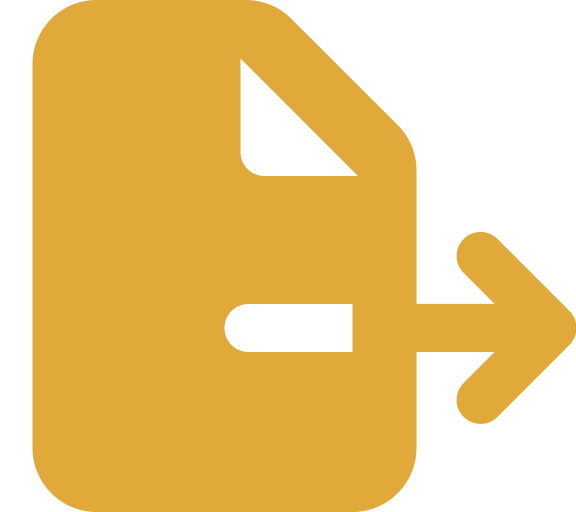
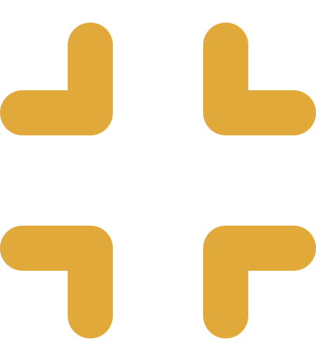

<div align="center">


# Better Trading

Bookmarks, history, pinned items and price conversion for **Path of Exile** and **Path of Exile 2**,
right inside the trade page.

<sub>**This product isn't affiliated with or endorsed by Grinding Gear Games in any way.**</sub>

[](https://chrome.google.com/webstore/detail/better-pathofexile-tradin/fhlinfpmdlijegjlpgedcmglkakaghnk)
[](https://addons.mozilla.org/en-US/firefox/addon/better-pathofexile-trading/)
[](https://github.com/poehubdev/better-trading/releases/latest)

[**Add to Chrome**](https://chrome.google.com/webstore/detail/better-pathofexile-tradin/fhlinfpmdlijegjlpgedcmglkakaghnk)
&nbsp;·&nbsp;
[**Add to Firefox**](https://addons.mozilla.org/en-US/firefox/addon/better-pathofexile-trading/)

<br />

<!-- TODO: add screenshot docs/readme/screenshots/hero.png -->


</div>

---

The trade site doesn't save your searches. Better Trading does, along with your history, the items you pinned and
prices converted to chaos or divine.

## Features

###  Bookmarks that stay organised

Save any search with one click and file it into folders. Give folders an icon (yes, ascendancy icons too), keep PoE 1
and PoE 2 apart, drag things into order, and archive what you're done with. Tick trades off as you buy, copy their URL,
or jump straight into a live search.

<!-- TODO: add screenshot docs/readme/screenshots/bookmarks.png -->


###  Path of Building import

Paste a Path of Building code and get a ready-made folder of searches for every item in the build. Gearing up a new
character goes from an evening to a coffee break.

<!-- TODO: add screenshot docs/readme/screenshots/pob-import.png -->


###  Share and back up

Send a folder to a friend as an export string, import theirs, or back up your whole collection to a file and restore it
on another machine.

<!-- TODO: add screenshot docs/readme/screenshots/share.png -->


###  History

Every search you run is remembered (the last 50), so the one you closed by accident is one click away.

<!-- TODO: add screenshot docs/readme/screenshots/history.png -->


###  Pinned items

Pin listings from the results and keep them in view while you keep refining the search.
Compare them side by side, then buy the best one.

<!-- TODO: add screenshot docs/readme/screenshots/pinned-items.png -->


###  Smarter results

- **Equivalent pricings**: prices also shown in chaos (or divine for chaos prices), using live
  [poe.ninja](https://poe.ninja/) rates.
- **Regroup similar results**: identical listings from the same seller at the same price collapse into one, with a
  toggle to expand them.

Each enhancer can be turned off on its own.

<!-- TODO: add screenshot docs/readme/screenshots/results.png -->


## Privacy

No accounts, no tracking. Everything is stored locally in your browser; the only outside request is fetching currency
rates from poe.ninja.

---

## Development

Built with [WXT](https://wxt.dev/), React 19 and TypeScript, one codebase for Chrome and Firefox.
Requires Node (`lts/jod`, see [`.nvmrc`](.nvmrc)) and [pnpm](https://pnpm.io/).

```sh
pnpm install
pnpm dev           # Chromium with the extension loaded, opens the trade site
pnpm dev:firefox   # same, for Firefox
pnpm storybook     # build UI components in isolation on :6006
```

| Command                         | What it does                               |
| ------------------------------- | ------------------------------------------ |
| `pnpm build` / `build:firefox`  | Production build into `.output/`           |
| `pnpm zip` / `zip:firefox`      | Store-ready zip into `.output/`            |
| `pnpm test`                     | Unit tests (vitest)                        |
| `pnpm compile`                  | Type check                                 |
| `pnpm lint` / `pnpm format`     | ESLint / Prettier                          |
| `pnpm pob-stats [poe2] [stats]` | Regenerate a game's PoB import stat data   |
| `pnpm pob-uniques [poe2] [sha]` | Sync a game's PoB import unique list       |

The Path of Building import reads committed data per game (`public/pob-stats.ndjson` and `public/pob-pools.json` for
PoE 1, the `-poe2` files for PoE 2) and loads only the imported Build Code's game. The stat lines and Mod Pools are
generated from the game files by [dat-mcp](https://github.com/poehubdev/dat-mcp): on a new patch, run
`npm run stats -- <poe1|poe2> <patch>` and `npm run pools -- <poe1|poe2> <patch>` there and regenerate here (the
recipe is in `AGENTS.md`). The data is pruned to Character Stats and gzipped by the build
([ADR 0004](docs/adr/0004-per-game-compressed-pob-data.md)). The unique lines come from
[Awakened PoE Trade](https://github.com/SnosMe/awakened-poe-trade) (PoE 1) and
[Exiled Exchange 2](https://github.com/Kvan7/Exiled-Exchange-2) (PoE 2): a weekly workflow opens a PR per game when
they change there. Details in `AGENTS.md` and [ADR 0002](docs/adr/0002-pob-stat-data-from-dat-mcp.md).

Architecture, conventions and the release process are in [`AGENTS.md`](AGENTS.md); domain terms (Folder, Trade,
Export String, …) in [`GLOSSARY.md`](GLOSSARY.md). Contributions welcome: pick or open an
[issue](https://github.com/poehubdev/better-trading/issues), build the UI in Storybook first, and keep `pnpm lint`,
`pnpm compile` and `pnpm test` green.

### Releasing

1. Point `changelog` in `package.json` at a new slug, write `changelogs/<slug>.md` (the in-app changelog) and commit.
2. `pnpm release patch` (or `minor`, `major`, `prerelease`, an exact version). It bumps the version, tags `vX.Y.Z`
   and pushes; the tag makes GitHub Actions build Chrome and Firefox and publish a
   [release](https://github.com/poehubdev/better-trading/releases) with the zips.

## Credits

Originally created by **InfaMc** ([@pboutin](https://github.com/pboutin)) and maintained by **brosmike**
([@dbjorge](https://github.com/dbjorge)). The Path of Building import's unique data comes from
[Awakened PoE Trade](https://github.com/SnosMe/awakened-poe-trade) by [@SnosMe](https://github.com/SnosMe).

Folder icons are Path of Exile game art, © Grinding Gear Games, used without a licence of their own (GGG grants none
for its art); they are not covered by anything else in this repository. The PoE 2 ascendancy icons are the game's
character select portraits of patch 0.5.5.10, extracted from the PoE 2 patch CDN by [dat-mcp](https://github.com/poehubdev/dat-mcp)'s
`ascendancy-icons` script.
